<div align="center">

<picture>
  <source media="(prefers-color-scheme: dark)" srcset="docs/assets/aster-logo-dark.svg">
  
</picture>

<h3>Infrastructure for continually self‑improving agents</h3>

[](https://github.com/ibrahimosman786/aster/actions/workflows/ci.yml)
[](https://pypi.org/project/aster-infra/)
[](pyproject.toml)
[](LICENSE)

<a href="https://github.com/ibrahimosman786/aster" target="_blank" rel="noopener noreferrer"></a>

English | [中文](README.zh.md)

<div align="left">

Aster is the first open-source infrastructure for continual self-improving agents.
It connects agent inference, feedback, learning, and versioned delivery. Use it
to train model weights with Slime and SGLang, or improve an agent's harness, including its prompts, rules, and skills.

## 🎯 When to use Aster

Use Aster when you want your agent to keep improving simply by learning from how you interact with your agent.

| Your goal | Learning path | What you need |
|---|---|---|
| Keep getting stronger model designed for you | Model weight training | A trainable model, a supported GPU stack, and feedback your recipe can use |
| Get your harness to self-improve | Harness optimization | A model endpoint, representative tasks, and an evaluator; no local training GPUs |
| Scientific discoveries | Test-time training | An execution environment, a correctness checker, and a measurable objective |


## 🧩 How Aster fits your stack

| Ability | Inference engine (vLLM, SGLang, …) | RL training framework (Slime, veRL, AReaL, …) | **Aster** |
|---|:---:|:---:|:---:|
| Serves live traffic | ✅ | ❌ | ✅ |
| Trains weights | ❌ | ✅ | ✅ |
| Version management | ❌ | ❌ | ✅ |
| Stays live through updates | ❌ | ❌ | ✅ |
| Evolves beyond weights (skills, harness) | ❌ | ❌ | ✅ |


## 🔄 How it works

<div align="center">
<picture>
  <source media="(prefers-color-scheme: dark)" srcset="docs/assets/loop-animation-dark.svg">
  
</picture>
</div>

Aster processes each learning cycle in four steps. The table also shows which
modules implement each step.

| Step | What happens | Where it lives |
|---|---|---|
| **1&nbsp;·&nbsp;Serve** | Serve agent requests and record interactions. | [`service/`](aster/service) — agent requests and interaction records<br>[`inference/`](aster/inference) — inference and artifact updates |
| **2&nbsp;·&nbsp;Observe** | Match feedback to recorded interactions. | [`storage/records.py`](aster/storage/records.py) — stored interactions and feedback<br>[`record2sample/`](aster/record2sample) — feedback matching, eligibility, and samples |
| **3&nbsp;·&nbsp;Grow** | Produce an update from eligible records. | [`recipe/`](aster/recipe) — recipe integration<br>[`train/`](aster/train) — the training pipeline, job data, and training jobs |
| **4&nbsp;·&nbsp;Commit** | Apply the configured selection policy and publish accepted updates. | [`evaluation/`](aster/evaluation) — candidate evaluation<br>[`artifact/`](aster/artifact) — version history and release components |


## 📦 Installation

> 💡 **Note**
>
> Aster's artifact and checkpoint functionality requires the `git-lfs` system
> package. Aster initializes Git LFS locally for its artifact repositories.

We recommend [uv](https://docs.astral.sh/uv/) for managing packages, and the
commands below use it.

### From PyPI

```bash
uv venv && source .venv/bin/activate
uv pip install aster-infra
python3 -c "import aster; print(aster.__version__)"
```

### From source

```bash
git lfs install
git clone https://github.com/ibrahimosman786/aster.git
cd aster
uv venv && source .venv/bin/activate
uv pip install -e .
python3 -c "import aster; print(aster.__version__)"
```

Use the source checkout for development and for the training examples below.


## 🔧 Using Aster

Aster supports two learning surfaces: model **weights** and agent **harnesses**.
The deployment's recipe determines which surface its scenarios update.

As a minimal example, start Aster as a pure inference server:

```bash
uv run aster serve --inference.model-path Qwen/Qwen2.5-1.5B-Instruct
```

### Weight-training deployment

#### Start the deployment

The following example starts the SAO (arXiv:2607.07508) example deployment. Run it
from an Aster checkout in an environment that satisfies the GPU requirements in
[Evolve your model](docs/user-guide/evolve-your-model.rst).

```bash
uv pip install -e ".[slime]" && uv pip install --no-deps --group runtime

export MODEL_PATH="Qwen/Qwen2.5-1.5B-Instruct"
export ASTER_TOKEN="aster-local"

aster serve -c recipes/sao/examples/imo_answerbench/serve.yaml \
  --inference.model-path "$MODEL_PATH" \
  --aster.port "8900"

curl -f http://127.0.0.1:8900/healthz          # ready to serve
```

#### Send an inference request and report feedback

Send inference requests through Aster and report a score for each response. The
SAO recipe uses each eligible scored rollout to run a training step.

Aster's inference endpoint is OpenAI- and Anthropic-compatible: `/v1/chat/completions`,
`/v1/responses` and `/v1/messages` take the provider's own request body. A request includes the
`x-aster-scenario` header; a new name creates a scenario using the deployment's
configured recipe. Requests do not select recipes.

The response body uses the provider's OpenAI-compatible format. Aster adds the
`x-aster-agent-record-id` response header. Its value is the **receipt** that a
later report uses to identify this interaction. A report can contain a numeric
`score`, textual or structured `feedback`, and the receipts it evaluates. This
example reports both a score and a short explanation.

```python
import os
import httpx

aster = httpx.Client(
    base_url="http://127.0.0.1:8900",
    headers={"Authorization": f"Bearer {os.environ['ASTER_TOKEN']}", "x-aster-scenario": "hello-aster"},
    timeout=300,
)

# Send a provider-compatible inference request
response = aster.post(
    "/v1/chat/completions",
    json={
        "model": os.environ["MODEL_PATH"],
        "messages": [{"role": "user", "content": "Return exactly: aster is ready"}],
    },
)

response.raise_for_status()
receipt = response.headers["x-aster-agent-record-id"]
answer = response.json()["choices"][0]["message"]["content"]

# Sending report about the inference
matched = answer.strip() == "aster is ready"

aster.post(
    "/aster/report",
    json={"score": float(matched), "feedback": "matched" if matched else "wrong answer", "references": [receipt]},
).raise_for_status()
```

`feedback` carries the richer signal, plain text or a structured object,
for recipes that read more than a scalar. The endpoint will validate the
**report schema** ([`aster/core/reports/`](aster/core/reports)).


#### Watch it learn and grow

Once the recipe has enough feedback, Aster submits a training job to the
training component. When a checkpoint that the job saved passes evaluation,
the inference runtime loads it as the new snapshot. Later inference requests
use the current version without restarting Aster.

### Harness-evolving deployment

Evolve a coding agent's skills and rules from scored feedback, using a model
API instead of GPUs.

A harness deployment serves `aster.recipe.harness:HarnessEvolutionRecipe`. The
recipe keeps the agent harness as a tree of text files. At each step, a method
edits a copy of that tree from the step's traces, the evaluation runs the real
agent on tasks with the candidate, and a candidate that wins publishes as a
snapshot that any client can pull. The
[harness evolution tutorial](tutorials/evolve-your-harness/README.md) runs the
smallest full loop on pi. It needs an OpenAI-compatible endpoint, and Node.js
and npm for pi. From your Aster checkout and activated Python environment:

```bash
cd tutorials/evolve-your-harness
./run.sh
```

`configs/serve.yaml` names the endpoint (`inference.upstream-url`, no `/v1`
suffix) and the model (`inference.upstream-model`). Edit them to point at your
own provider, and set `ASTER_UPSTREAM_API_KEY` if the endpoint needs a key.
`run.sh` starts Aster on `127.0.0.1:8900`, sends the tasks through it, reports
each score, and pulls the published tree. Each run writes `work/replay.html`
with the snapshot chain and the files each step changed.

`GET /aster/harness` serves the published tree, rendered for the deployment's
adapter. The files carry no endpoint, key, or model: a client writes them
where the agent reads them and binds the agent's model to this Aster (see
[Use a published tree](docs/user-guide/evolve-your-harness.rst)).
Write the tree outside the project the agent works in: a session can write
files in its project, so a tree there could change what the next session
runs. [Evolve agent prompts, rules, and skills](docs/user-guide/evolve-your-harness.rst)
explains the loop and its configuration.

## 📚 Recipes and examples

Pick a recipe by the **task type** of your workload and by **what it should
evolve**, model weights or the agent harness. Weight recipes need the GPU
training stack, while harness recipes need only a model endpoint. Each recipe
below links to its guide and each measured benchmark links to its results
page, and the [recipe catalog](docs/user-guide/recipes.rst)
adds the code and example for every recipe.
[SFT](docs/user-guide/recipes/sft.rst) ships with `aster-infra`
and trains on demonstrations or imported examples for every task type.
The other implementations live in this repository's `recipes/` cookbook,
selected by dotted class reference and not shipped in the Aster wheel.

| Task type | Task shape | Evolves the model | Evolves the harness | Standard benchmarks |
|---|---|---|---|---|
| Open-ended discovery | Repeated attempts at one hard problem with a measurable objective and no known answer | [TTT-Discover](docs/user-guide/recipes/tttd.rst), [Guidance-TTT](recipes/tttd/examples/guidance_ttt/README.md) | None yet | Measured: [TriMul](recipes/tttd/examples/guidance_ttt/results/README.md), [circle packing](recipes/tttd/examples/tttd/README.md#formal-8x64-results), [Erdős minimum overlap](recipes/tttd/examples/tttd/README.md#formal-8x64-results). |
| Offline tasks with a known answer | Independent tasks from a fixed set, each with a reference answer | [SAO](docs/user-guide/recipes/sao.rst), [SDFT](docs/user-guide/recipes/sdft.rst), [SDPO](docs/user-guide/recipes/sdpo.rst), [OPD](docs/user-guide/recipes/opd.rst) | [GEPA](docs/user-guide/recipes/gepa.rst), [Meta-Harness](recipes/meta_harness/README.md) | Measured: [IMOAnswerBench](recipes/sao/examples/imo_answerbench/README.md#results), [AIME 2024](recipes/opd/examples/math/README.md#results), [AIME 2025](recipes/gepa/examples/aime/README.md#the-validation-contract), [SciKnowEval](recipes/sdpo/examples/sciknoweval/README.md#results), [ToolAlpaca](recipes/sdft/examples/skill_stream/README.md#results), [Terminal-Bench](recipes/meta_harness/examples/terminal_bench/README.md#results). |
| Online learning from usage | Sessions with a user, where the interaction itself is the signal | [OpenClaw-RL](docs/user-guide/recipes/openclawrl.rst) | [ACE](recipes/ace/README.md), [ReasoningBank](recipes/reasoning_bank/README.md) | Measured: [GSM8K with a simulated student user](recipes/openclawrl/examples/openclawrl/README.md#results). |

[`recipes/basic/`](recipes/basic/) is the record-only starting stack and stays
outside the catalog. For a small walkthrough of feedback, candidate edits, and
publication, start with [the coding harness tutorial](tutorials/evolve-your-harness/README.md).
Each result page documents its task, evaluation setup, measurements, and
limitations.


## 📐 Architecture

<div align="center">
<picture>
  <source media="(prefers-color-scheme: dark)" srcset="docs/assets/architecture-dark.svg">
  
</picture>
</div>

## 📖 Learn more

The [documentation](docs/getting-started/intro.rst) is organized in the following order:

- [Quickstart](docs/getting-started/quickstart.rst): install Aster, connect a client, and inspect the version history
- [HTTP API](docs/reference/http-api.rst): use the HTTP API and report feedback
- [Write a recipe](docs/developer-guide/write-a-recipe.rst): configure how Aster processes data and produces updates
- [Evolve your harness](docs/user-guide/evolve-your-harness.rst): evolve a harness instead of model weights
- [Evolve your model](docs/user-guide/evolve-your-model.rst): configure and operate a training deployment
- [Recipes](docs/user-guide/recipes.rst): the catalog of cookbook
  recipes by task type, with code, docs, example, and results for each
- [The core loop](docs/getting-started/core-loop.rst): The core loop of Aster
- [Glossary](docs/reference/glossary.rst): Explanation of the terminologies used

## 🤝 Community & Contributing

Working on continual self-improving agent?

- [Join Discord](https://discord.gg/5y8e5f937k) to share your recipes, ask implementation questions, and discuss new features.
- [Join the WeChat group](docs/community/wechat.md): the group is full, so add the assistant and it will invite you.
- Join the [GitHub Discussions](https://github.com/ibrahimosman786/aster/issues) to ask questions, share ideas, and connect with the community.
- Start contributing with the [contribution guide](CONTRIBUTING.md).
- Propose designs through an [RFC issue](https://github.com/ibrahimosman786/aster/issues).
- Report suspected vulnerabilities privately by following the [security policy](SECURITY.md).

If Aster looks useful to you, please give it a ⭐ — it helps the community to discover and contribute to the project.


## 📚 Citation

If you use Aster in your research, please cite:

```bibtex
@misc{aster2026,
  title  = {Aster: Infrastructure for Continually Self-Improving Agents},
  author = {{Aster Contributors}},
  year   = {2026},
  url    = {https://github.com/ibrahimosman786/aster}
}
```

Citation metadata is also available in [CITATION.cff](CITATION.cff).


## 👥 The Team

Aster brings together people exploring how agents can learn from experience and
improve over time. The people below help turn that idea into working infrastructure.

This list is non-exhaustive, with team members listed alphabetically by last name:

[Wenhao Chai](https://github.com/wenhaochai),
[Shuangrui Ding](https://github.com/Mark12Ding),
[Shiyi Zoe Du](https://github.com/zoedsy),
[Hao He](https://github.com/hehaodele),
[Haoze He](https://github.com/HectorHHZ),
[Chonghe Jiang](https://github.com/Chonghe-Jiang),
[Nan Jiang](https://github.com/nanjiangwill),
[Xuan Jiang](https://github.com/Xuan-1998),
[Xiaochen Li](https://github.com/SeuperHakkerJa),
[Paul Liang](https://github.com/pliang279),
[Bo Liu](https://github.com/Benjamin-eecs),
[Boyuan Long](https://github.com/BoyuanLong),
[Qiuyang Mang](https://github.com/joyemang33),
[Zhenting Qi](https://github.com/zhentingqi),
[Ao Qu](https://github.com/quao627),
[Mingruo Qu](https://github.com/workhardforcoding),
[Yihong Tang](https://github.com/YihongT),
[Zhaokai Wang](https://github.com/wzk1015),
[Xuezhi Yan](https://github.com/yanxz),
[Hanfei Yu](https://github.com/hanfeiyu),
[Haofei Yu](https://github.com/lwaekfjlk),
[Simon Yu](https://github.com/simonucl),
[Han Zheng](https://github.com/MikeZheng777),
[Kaichen Zhou](https://github.com/kaichen-z),
[Zijian Zhou](https://github.com/BobbyZhouZijian),
[Jiacheng Zhu](https://github.com/Jiacheng-Zhu-AIML),
[Dingyi Zhuang](https://github.com/ZhuangDingyi),
[Xinkai Zou](https://github.com/jayzou3773).


## ⭐ Star History

<a href="https://star-history.com/#ibrahimosman786/aster&Date">
  <picture>
    <source media="(prefers-color-scheme: dark)" srcset="https://api.star-history.com/chart?repos=ibrahimosman786/aster&type=date&legend=top-left&theme=dark" />
    <source media="(prefers-color-scheme: light)" srcset="https://api.star-history.com/chart?repos=ibrahimosman786/aster&type=date&legend=top-left" />
    
  </picture>
</a>


## 🙏 Acknowledgements

We are particularly grateful to these projects which power important parts of Aster:

- [SGLang](https://github.com/sgl-project/sglang) — high-performance inference
- [slime](https://github.com/THUDM/slime) — model weight training
